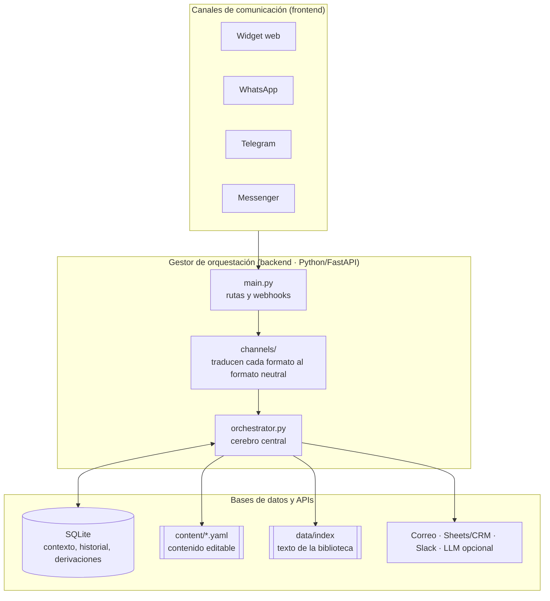
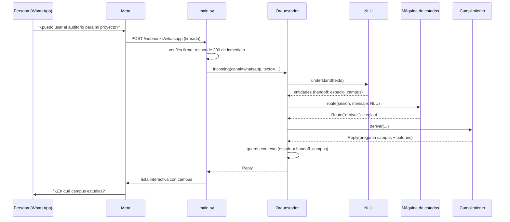

# 01 · Arquitectura

CEIBA bot se organiza en tres niveles, de lo más general a lo más específico. Cada nivel vive en carpetas distintas para que una persona pueda trabajar en uno sin tocar los otros.

| Nivel | Pregunta que responde | Carpetas |
|---|---|---|
| **Macro · Sistema** | ¿Dónde vive el bot y cómo se conecta? | `channels/`, `main.py`, `orchestrator.py`, `storage/`, `integrations/` |
| **Medio · Comprensión** | ¿Qué quiso decir la persona? | `nlu/`, `dialogue/context.py`, `content/intents.yaml`, `content/entities.yaml` |
| **Micro · Flujo y código** | ¿Qué hace el bot exactamente? | `dialogue/state_machine.py`, `fulfillment/`, `rag/` |

---

## Nivel macro: arquitectura del sistema

**Canales (frontend).** Cada plataforma envía mensajes en su propio formato. Los adaptadores de `channels/` los convierten en un `Incoming` neutral y convierten la `Reply` del bot en botones, listas o tarjetas que esa plataforma acepta, respetando sus límites. La lógica del bot se escribe una sola vez.

**Orquestador (middleware).** `orchestrator.py` recibe el mensaje, aplica el límite anti-spam, carga el contexto de la persona, pide al NLU que lo interprete, pide a la máquina de estados que elija el camino, ejecuta la función de cumplimiento, divide los textos largos y guarda todo.

**Datos y APIs.** SQLite guarda el contexto de cada persona (perfil, paso de la evaluación, lecturas sugeridas), el historial con datos personales ocultos y las derivaciones. El contenido vive en YAML para que se edite sin programar. Los servicios externos (correo, webhooks, LLM) son opcionales y se activan en `.env`.

### Recorrido de un mensaje

---

## Nivel medio: procesamiento y comprensión (NLU)

| Concepto | Qué es | Ejemplo en CEIBA bot | Dónde se edita |
|---|---|---|---|
| **Intención** | El propósito del mensaje | «¿cuándo es la Semana Tec?» → `ver_calendario` | `content/intents.yaml` |
| **Entidad** | Un dato concreto dentro del mensaje | «soy de mty» → `campus = monterrey` | `content/entities.yaml` |
| **Contexto** | Lo que el bot recuerda para no perder el hilo | Está en la pregunta 3 de 6 de la evaluación; nivel intermedio; ya leyó el Acuerdo de París | `dialogue/context.py` (se guarda solo) |

**Motor por defecto: reglas transparentes.** El clasificador (`nlu/intent_classifier.py`) compara el mensaje con palabras clave y frases de ejemplo de cada intención. Es predecible, gratuito, funciona sin internet y no envía conversaciones a terceros. Cualquier editor ve por qué el bot entendió lo que entendió (`python scripts/chat_cli.py --debug` muestra intención y confianza).

**Cuándo cambiar a un modelo.** Si el registro `unmatched` (mensajes no entendidos) crece aunque se agreguen ejemplos, se puede sustituir el clasificador por embeddings o un LLM sin tocar el resto: basta con conservar la interfaz `understand(texto) → NLUResult`. Herramientas como Rasa o Dialogflow cumplen el mismo papel, pero agregan infraestructura y, en el caso de Dialogflow, envían los mensajes a la nube de Google.

---

## Nivel micro: flujo y código

**Máquina de estados.** `dialogue/state_machine.py` decide qué función atiende cada mensaje, con 10 reglas en orden de prioridad (botón tocado, comandos globales, derivación, lo que el estado actual espera, FAQ, intención, glosario, biblioteca, fallback). El diagrama y las reglas completas están en [04_FLUJOS_CONVERSACIONALES.md](04_FLUJOS_CONVERSACIONALES.md).

**Funciones de cumplimiento (fulfillment).** `fulfillment/` tiene una función por intención, registrada con `@handler("nombre")`. Cada una arma la respuesta con el contenido de los YAML y, cuando hace falta, ejecuta acciones en tiempo real: consultar la biblioteca, guardar el perfil, generar un código de continuidad o avisar a una secretaría.

---

## Decisiones de diseño y por qué

| Decisión | Alternativa descartada | Motivo |
|---|---|---|
| RAG con la biblioteca como única fuente | Dejar que un LLM responda libremente | Un LLM sin fuentes inventa fechas y acuerdos. Con RAG, si el dato no está en los documentos, el bot lo dice |
| Respuestas **extractivas** por defecto (`LLM_PROVIDER=none`) | LLM obligatorio | Cero costo por mensaje, cero alucinaciones, sin dependencia de un proveedor. El LLM se activa en `.env` si se quiere un tono más fluido |
| **No** usar U-Net | U-Net para «procesar bibliografía» | U-Net es una red de segmentación de **imágenes** (por ejemplo, imágenes médicas). No sirve para texto. Para textos se usan búsqueda léxica (BM25), embeddings y transformers |
| BM25 + expansión bilingüe | Embeddings desde el inicio | BM25 no requiere GPU ni descargar modelos. La biblioteca está en inglés y francés y la gente pregunta en español; `entities.yaml → query_expansion` cubre los términos clave. Los embeddings multilingües quedan como opción (`RAG_RETRIEVER=embeddings`) |
| SQLite | PostgreSQL / base vectorial (ChromaDB, Pinecone) | Con 16 documentos y el volumen de un programa estudiantil, SQLite basta y no requiere servidor. `storage/db.py` aísla el acceso para migrar sin tocar el resto |
| Contenido en YAML | Contenido dentro del código | Varias personas no técnicas editan el bot. YAML admite comentarios `# EDITA AQUÍ` y GitHub lo muestra legible |
| El bot no recoge datos de inscripción | Formulario dentro del chat | El formulario oficial ya gestiona consentimiento y tutores de menores (LFPDPPP). Duplicarlo en el chat multiplica el riesgo |
| Continuidad entre dispositivos con código `CEIBA-XXXX` | Inicio de sesión con correo | En WhatsApp y Telegram la identidad ya es el teléfono o la cuenta. En la web, un código temporal evita pedir datos personales |

---

## Limitaciones conocidas (honestas)

1. **BM25 no entiende sinónimos ni paráfrasis lejanas.** «¿Qué acordaron los países en 2015?» puede no encontrar el Acuerdo de París si no aparece «París» ni «2015» en el catálogo. Mitigación: agregar `keywords` y pares en `query_expansion`, o activar embeddings.
2. **Algunas páginas de la UNFCCC no se dejan descargar** por la ingesta (devuelven una página de verificación anti-bots). Para esos documentos el bot usa el resumen y los `key_facts` del catálogo, que son la fuente principal de todas formas.
3. **El limitador anti-spam vive en memoria.** Con varias instancias del servidor, cada una cuenta por separado; usa Redis si escalas (ver [07_DESPLIEGUE.md](07_DESPLIEGUE.md)).
4. **La ruta de embeddings no corre en la integración continua** (requiere descargar un modelo). Pruébala localmente antes de activarla.
