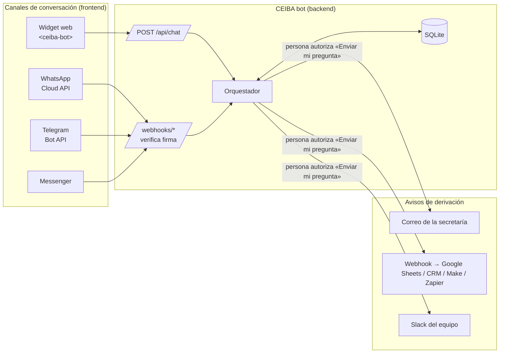

# 03 · Conectividad: canales, contactos e integraciones

Este documento explica cómo conectar CEIBA bot con el mundo exterior: dónde conversa la gente (canales), a quién avisa cuando deriva una duda (integraciones salientes) y dónde se configura cada número, correo o token.

> **Regla de oro:** los **datos de contacto institucionales** (correos, teléfonos de oficina, horarios) van en `content/contacts.yaml`. Las **credenciales** (tokens, contraseñas, secretos) van en `.env`. Nunca al revés, y nunca en el código.

---

## 1. Mapa de conectividad



### Dónde se configura cada cosa

| Qué | Dónde | Variable o campo |
|---|---|---|
| Correo, teléfono, WhatsApp y horario de **coordinación CEIBA** | `content/contacts.yaml` → `general` | `email`, `phone`, `whatsapp`, `hours` |
| Contacto de la **secretaría de cada campus** (quien recibe las derivaciones) | `content/contacts.yaml` → `campuses` | `email`, `phone`, `whatsapp`, `hours` |
| Redes sociales que muestra el bot | `content/contacts.yaml` → `social` | `url` |
| Aviso de privacidad y formulario de inscripción | `content/contacts.yaml` → `general` | `privacy_url`, `form_url` |
| URL pública del servidor | `.env` | `PUBLIC_BASE_URL` |
| Dominios autorizados para el widget | `.env` | `ALLOWED_ORIGINS` |
| Número del bot en WhatsApp | `.env` | `WHATSAPP_PHONE_NUMBER_ID`, `WHATSAPP_TOKEN` |
| Bot de Telegram | `.env` | `TELEGRAM_BOT_TOKEN`, `TELEGRAM_SECRET_TOKEN` |
| Página de Facebook | `.env` | `MESSENGER_PAGE_TOKEN` |
| Seguridad de webhooks de Meta | `.env` | `META_APP_SECRET`, `META_VERIFY_TOKEN` |
| Destinos de los avisos | `.env` | `NOTIFY_TARGETS`, `SMTP_*`, `NOTIFY_WEBHOOK_URL`, `SLACK_WEBHOOK_URL` |

### Dos números de WhatsApp distintos (no los confundas)

`contacts.yaml → whatsapp` es el número **de una persona o secretaría** que atiende desde su teléfono; el bot lo muestra como botón «💬 Escribir por WhatsApp» (`https://wa.me/<número>`). `WHATSAPP_PHONE_NUMBER_ID` en `.env` identifica el número **del bot** en la Cloud API. Por regla general, un número registrado en la Cloud API deja de poder usarse en la app normal de WhatsApp; Meta ofrece un modo de coexistencia con la app WhatsApp Business en algunos casos, así que confírmalo en la documentación vigente antes de reutilizar un número. Lo más simple es usar un número nuevo para el bot.

---

## 2. Modo de prueba antes de conectar nada

Con `CHANNEL_DRY_RUN=true` (valor por defecto) el bot procesa los webhooks normalmente pero, en lugar de enviar las respuestas a Meta o Telegram, las escribe en `data/outbox.jsonl`. Así se prueba todo el flujo sin tokens. Las pruebas automáticas (`backend/tests/test_channels.py`) simulan mensajes reales de cada plataforma y verifican firmas y límites.

Para que Meta o Telegram alcancen tu computadora durante el desarrollo necesitas una URL pública https temporal:

```bash
uvicorn app.main:app --app-dir backend --port 8000
cloudflared tunnel --url http://localhost:8000      # o bien: ngrok http 8000
```

Copia la URL que te entrega (`https://algo.trycloudflare.com`) en `PUBLIC_BASE_URL` y úsala en los paneles de cada plataforma. Cambia a `CHANNEL_DRY_RUN=false` cuando los tokens estén listos.

---

## 3. Sitio web (widget)

**Incrustar en el sitio de CEIBA** (o en cualquier página, CMS o app híbrida):

```html
<script type="module" src="https://TU-SERVIDOR/widget/ceiba-bot.js"></script>
<ceiba-bot api="https://TU-SERVIDOR"></ceiba-bot>
```

Para una página dedicada a pantalla completa, con el menú lateral en laptop: `<ceiba-bot api="…" mode="inline"></ceiba-bot>` dentro de un contenedor con altura definida.

**Requisitos:**

1. Agrega el dominio del sitio a `ALLOWED_ORIGINS` (por ejemplo `https://ceiba.tec.mx`). Sin esto, el navegador bloquea las llamadas (error CORS en la consola).
2. Sirve el backend con **https**. Un sitio https no puede llamar a una API http.
3. Si el sitio usa *Content Security Policy*, permite `script-src` y `connect-src` hacia `https://TU-SERVIDOR`.
4. Colores: el widget hereda variables CSS desde la página: `ceiba-bot { --cb-primary: #1E6B4F; --cb-accent: #F2B33D; }`.

**Contrato de la API** (útil para otra interfaz, como una app móvil):

```http
POST /api/chat
{"session_id": "uuid-del-dispositivo", "text": "hola"}          → mensaje escrito
{"session_id": "...", "payload": "i:ver_programas"}               → botón tocado
{"session_id": "...", "event": "start"}                           → abrir el chat

200 OK
{"messages": ["…"], "buttons": [{"label","payload","short","desc"}],
 "cards": [{"title","body","tag","url","url_label","download_url","buttons"}], "meta": {…}}
```

---

## 4. WhatsApp (WhatsApp Business Platform · Cloud API)

### 4.1 Política de uso: verifícala antes de publicar

Desde el **15 de enero de 2026** los términos de WhatsApp Business prohíben distribuir **chatbots de IA de propósito general** por la API. Siguen permitidos los bots **específicos de un negocio o servicio** (atención, preguntas frecuentes, orientación, canalización a personas). CEIBA bot entra en la segunda categoría siempre que conserve su alcance: responde solo sobre CEIBA y su biblioteca, rechaza temas ajenos («No encontré esa información en mis fuentes oficiales») y ofrece siempre un camino a una persona. **No conviertas el bot en un asistente abierto** (por ejemplo, activando un LLM sin la biblioteca como única fuente), porque eso pondría en riesgo el número.

### 4.2 Pasos de configuración

1. **Cuenta y app.** En [developers.facebook.com](https://developers.facebook.com) crea una app de tipo *Business* y agrega el producto **WhatsApp**. Meta asigna un número de prueba y permite enviar mensajes a hasta 5 números verificados.
2. **Identificador del número.** En *WhatsApp → Configuración de la API* copia el **Identificador del número de teléfono** en `WHATSAPP_PHONE_NUMBER_ID`. No es el número en sí: es un id numérico largo.
3. **Token permanente.** El token que aparece en la página de pruebas vence en 24 horas. Para producción, en *Business Settings → Usuarios → Usuarios del sistema* crea un usuario del sistema, asígnale la app y la cuenta de WhatsApp, y genera un token con los permisos `whatsapp_business_messaging` y `whatsapp_business_management`. Guárdalo en `WHATSAPP_TOKEN`.
4. **Secreto de la app.** En *Configuración de la app → Básica* copia la **Clave secreta** en `META_APP_SECRET`. El bot la usa para comprobar que cada webhook viene de Meta (cabecera `X-Hub-Signature-256`). Sin ella, en producción el bot rechaza todos los mensajes.
5. **Webhook.** En *WhatsApp → Configuración*:
   - URL de devolución de llamada: `https://TU-SERVIDOR/webhooks/whatsapp`
   - Token de verificación: el mismo texto que pusiste en `META_VERIFY_TOKEN`
   - Pulsa *Verificar y guardar* y **suscríbete al campo `messages`**.
6. **Versión de la API.** Revisa la versión vigente en el *changelog* de la Graph API y ajústala en `META_GRAPH_VERSION`.
7. **Número real.** Para salir de pruebas, agrega un número propio, aprueba el nombre visible y, si Meta lo pide, completa la verificación del negocio para ampliar los límites de envío.

### 4.3 Reglas de mensajería que el código ya respeta

| Regla de WhatsApp | Cómo la maneja el bot |
|---|---|
| Hasta 3 botones de respuesta, título ≤ 20 caracteres | Si hay 3 o menos, usa botones con el texto `short` de los YAML |
| Lista de hasta 10 opciones, título ≤ 24, descripción ≤ 72 | Si hay más de 3, envía una lista con botón «Ver opciones» |
| Botón con enlace, texto ≤ 20 | Las tarjetas (lecturas, contactos) salen como mensaje `cta_url` |
| Formato: `*negritas*` | Convierte `**texto**` a `*texto*` y los enlaces a «texto: url» |
| Ventana de servicio de 24 h | El bot solo responde a mensajes entrantes, siempre dentro de la ventana. Para mensajes proactivos (recordatorios) se necesitan **plantillas aprobadas** y consentimiento previo; no están implementadas |

El validador (`scripts/validate_content.py`) bloquea textos `short` que excedan estos límites.

**Costos:** Meta cobra por mensajes de plantilla; las respuestas dentro de la ventana de servicio no se cobran según la política vigente al escribir esta guía. Revisa la tabla de precios actual de WhatsApp Business antes de presupuestar.

---

## 5. Telegram

1. En Telegram, abre **@BotFather**, envía `/newbot`, elige nombre y usuario (debe terminar en `bot`). Copia el token en `TELEGRAM_BOT_TOKEN`.
2. Inventa un secreto (letras, números, `_` y `-`) y ponlo en `TELEGRAM_SECRET_TOKEN`.
3. Con `PUBLIC_BASE_URL` en https, registra el webhook:
   ```bash
   python scripts/set_telegram_webhook.py          # registra
   python scripts/set_telegram_webhook.py --info   # comprueba
   ```
   Telegram enviará el secreto en la cabecera `X-Telegram-Bot-Api-Secret-Token` y el bot rechazará cualquier petición que no lo traiga.
4. Opcional en @BotFather: `/setdescription`, `/setuserpic` y `/setcommands` con `start - Iniciar` y `menu - Ver opciones`.

**Límites que respeta el código:** `callback_data` ≤ 64 bytes (por eso los *payloads* son cortos), texto ≤ 4096, dos botones por fila. El formato se envía en HTML escapado, así que nadie puede inyectar etiquetas.

---

## 6. Facebook Messenger

1. Necesitas una **página de Facebook** de CEIBA con rol de administrador.
2. En la misma app de Meta, agrega el producto **Messenger**, conecta la página y genera el **token de acceso de la página** → `MESSENGER_PAGE_TOKEN`.
3. Webhook: URL `https://TU-SERVIDOR/webhooks/messenger`, el mismo `META_VERIFY_TOKEN`, y suscribe la página a `messages` y `messaging_postbacks`.
4. Botón «Empezar» (opcional):
   ```bash
   curl -X POST "https://graph.facebook.com/<versión>/me/messenger_profile?access_token=<TOKEN>" \
        -H "Content-Type: application/json" -d '{"get_started":{"payload":"GET_STARTED"}}'
   ```
5. Para que cualquier persona (no solo administradores y testers) pueda escribir, la app debe pasar la **revisión de Meta** del permiso `pages_messaging`.

**Límites:** respuestas rápidas ≤ 13 con título ≤ 20, tarjetas en plantilla genérica (≤ 10, título y subtítulo ≤ 80), texto ≤ 2000 y sin formato. Messenger también aplica una ventana estándar de 24 h.

---

## 7. Avisos de derivación (a quién le llega la información)

Cuando el bot deriva una duda y la persona toca **«📨 Sí, enviar mi pregunta»**, se envía un aviso con el campus, el motivo y el texto de la pregunta (con correos y teléfonos ocultos). Activa uno o varios destinos en `NOTIFY_TARGETS` (por ejemplo `email,webhook`).

### 7.1 Correo a la secretaría

El aviso llega al `email` del campus en `contacts.yaml`; si está vacío, al correo general de CEIBA.

```env
NOTIFY_TARGETS=email
SMTP_HOST=smtp.office365.com        # Microsoft 365 institucional · Gmail: smtp.gmail.com
SMTP_PORT=587
SMTP_USER=ceiba-bot@tu-dominio.mx
SMTP_PASSWORD=                      # contraseña de aplicación, no la personal
SMTP_FROM=CEIBA bot <ceiba-bot@tu-dominio.mx>
```

Usa una cuenta de servicio dedicada. Muchas instituciones bloquean SMTP básico; si es tu caso, pide a TI un relay SMTP o usa el webhook con Power Automate.

### 7.2 Webhook a Google Sheets (registro de derivaciones)

1. Crea una hoja de cálculo, abre *Extensiones → Apps Script* y pega:

```javascript
// Recibe avisos de CEIBA bot y los agrega como filas.
const CLAVE = 'pon-aqui-una-clave-larga';   // EDITA AQUÍ: la misma que va al final de NOTIFY_WEBHOOK_URL

function doPost(e) {
  if (e.parameter.key !== CLAVE) return ContentService.createTextOutput('no autorizado');
  const d = JSON.parse(e.postData.contents);
  const hoja = SpreadsheetApp.getActiveSpreadsheet().getSheets()[0];
  if (hoja.getLastRow() === 0) hoja.appendRow(['Fecha', 'Folio', 'Campus', 'Motivo', 'Pregunta', 'Canal', 'Atendido']);
  hoja.appendRow([new Date(), d.id, d.campus_name, d.reason, d.question, d.channel, '']);
  return ContentService.createTextOutput('ok');
}
```

2. *Implementar → Nueva implementación → Aplicación web*, ejecutar como tú, acceso «Cualquier usuario». Copia la URL.
3. En `.env`:
   ```env
   NOTIFY_TARGETS=webhook
   NOTIFY_WEBHOOK_URL=https://script.google.com/macros/s/XXXX/exec?key=pon-aqui-una-clave-larga
   ```

Apps Script no expone las cabeceras HTTP, por eso la clave viaja en la URL. Con receptores que sí leen cabeceras (Make, n8n, tu API), usa `NOTIFY_WEBHOOK_SECRET` y verifica `X-Ceiba-Signature: sha256=<HMAC del cuerpo>`.

**Formato del aviso (JSON):**

```json
{"type": "handoff", "id": 12, "campus": "monterrey", "campus_name": "Campus Monterrey",
 "category": "espacio_campus", "reason": "Pregunta sobre un espacio del campus",
 "question": "¿Puedo usar el auditorio para mi proyecto?", "channel": "whatsapp"}
```

El mismo webhook sirve para Make, Zapier, n8n, Power Automate o un CRM (HubSpot, Salesforce) que acepte JSON entrante.

### 7.3 Slack

Crea un *Incoming Webhook* para el canal del equipo y ponlo en `SLACK_WEBHOOK_URL` con `NOTIFY_TARGETS=slack`.

### 7.4 Inscripciones

El bot **no** recoge datos personales por chat: envía a la persona al formulario oficial (`contacts.yaml → general.form_url`, o `#participa` del sitio), que ya pide consentimiento y autorización de tutor para menores. Si conectas ese formulario a la misma hoja de Google, tendrás inscripciones y derivaciones en un solo lugar.

---

## 8. Seguridad de la conectividad

| Riesgo | Protección incluida |
|---|---|
| Alguien falsifica un webhook de Meta | Firma HMAC `X-Hub-Signature-256` con `META_APP_SECRET`. En `APP_ENV=production` sin secreto se rechaza todo |
| Alguien falsifica un webhook de Telegram | Cabecera `X-Telegram-Bot-Api-Secret-Token` comparada en tiempo constante |
| Spam o abuso | Límite de `RATE_LIMIT_PER_MINUTE` mensajes por persona |
| Otro sitio usa tu widget | `ALLOWED_ORIGINS` (CORS) |
| Fuga de números de teléfono | El id del canal se guarda como hash HMAC con `USER_HASH_SALT`; correos y teléfonos se ocultan en los registros |
| Tokens filtrados en GitHub | `.env` está en `.gitignore`; los envíos simulados no guardan URLs con tokens |
| Respuestas lentas provocan reintentos de Meta | Los webhooks responden de inmediato y procesan en segundo plano |

---

## 9. Agregar un canal nuevo (Instagram, Microsoft Teams, etc.)

1. Crea `backend/app/channels/<canal>.py` con una clase que herede de `Channel` e implemente `parse()` (webhook → `Incoming`) y `render()` (`Reply` → llamadas a la API del proveedor). Usa `whatsapp.py` como modelo.
2. Regístrala en `CHANNELS` (`channels/__init__.py`) y agrega sus rutas en `main.py`, verificando la firma del proveedor.
3. Agrega variables a `.env.example` y una prueba en `backend/tests/test_channels.py` con un webhook de ejemplo.

Instagram Direct usa la misma infraestructura de Meta que Messenger, así que su adaptador sería muy parecido a `messenger.py`.

---

## 10. Problemas frecuentes

| Síntoma | Causa probable | Solución |
|---|---|---|
| Meta dice «No se pudo validar la URL» | `META_VERIFY_TOKEN` distinto o servidor no accesible | Compara el token; abre `https://TU-SERVIDOR/health` desde el celular |
| WhatsApp verifica pero el bot no responde | No te suscribiste al campo `messages` o `CHANNEL_DRY_RUN=true` | Suscríbete; revisa `data/outbox.jsonl`; cambia a `false` |
| Error 401 en los logs del webhook | `META_APP_SECRET` incorrecto | Copia de nuevo la clave secreta de la app |
| Error 190 o «token expired» de Meta | Usaste el token temporal de 24 h | Genera el token del usuario del sistema |
| Error 131047 de WhatsApp | Pasaron más de 24 h desde el último mensaje de la persona | Solo se puede responder dentro de la ventana; fuera requiere plantilla |
| Telegram no recibe nada | Webhook no registrado o URL http | `python scripts/set_telegram_webhook.py --info` |
| El widget muestra «No pude conectarme» | CORS, http/https mezclados o servidor caído | Consola del navegador (F12) y `ALLOWED_ORIGINS` |
| No llegan correos de derivación | SMTP bloqueado o `NOTIFY_TARGETS` vacío | Revisa los logs («Falló el aviso por email») |
