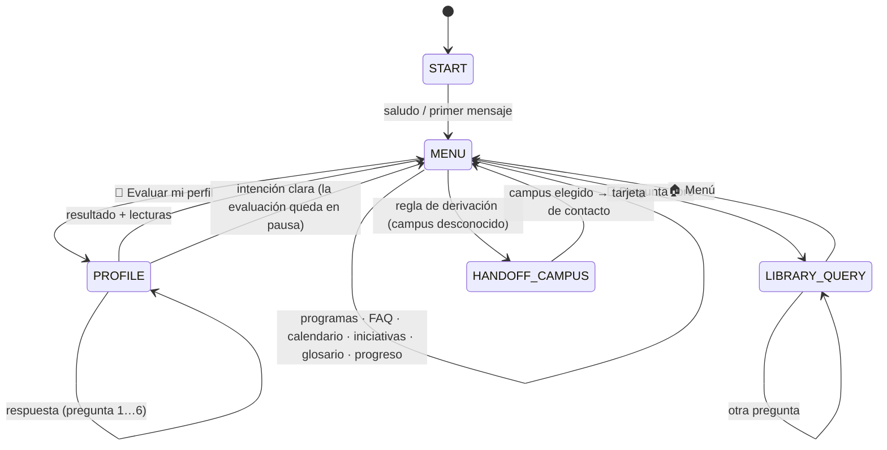
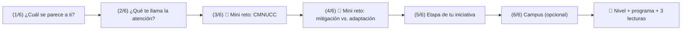

# 04 · Flujos conversacionales (máquina de estados)

## Estados



`START`, `MENU`, `PROFILE`, `LIBRARY_QUERY` y `HANDOFF_CAMPUS` están en `backend/app/dialogue/states.py`. El estado y el paso de la evaluación se guardan por persona, así que si alguien interrumpe la evaluación para preguntar una fecha y vuelve después, retoma en la misma pregunta.

## Árbol de decisión: las 10 reglas (en orden)

`backend/app/dialogue/state_machine.py → route()` evalúa estas reglas en orden y se queda con la primera que aplica:

| # | Regla | Ejemplo | Función |
|---|---|---|---|
| 1 | La persona tocó un botón | `q:perfil:estudiante` | según el payload |
| 2 | Abrió el chat | `/start`, abrir el widget | `saludo` |
| 3 | Comando global | «borrar mis datos», «retomar CEIBA-7K3P», «menú» | `borrar_datos`, `retomar`, `menu` |
| 4 | **Regla de derivación** | «¿puedo usar el auditorio?» | `derivar` |
| 5 | Lo que el estado espera | en `PROFILE`: «2» o «crear mi iniciativa» | `profile_answer` |
| 6 | Pregunta frecuente con buena coincidencia | «¿cuánto dinero dan?» | `faq` |
| 7 | Intención reconocida | «¿qué programas tienen?» | la de la intención |
| 8 | Término del glosario | «CMNUCC» | `definir_termino` |
| 9 | Puede ser pregunta de contenido | «¿qué es el balance mundial?» | `pregunta_climatica` (RAG) |
| 10 | Nada encaja | «receta de pastel» | `fallback` → tras 2 intentos, contacto humano |

## Esquema de payloads (botones)

| Payload | Significado |
|---|---|
| `i:<intención>[:arg]` | Ejecuta una intención (`i:ver_calendario`, `i:evaluar_perfil:reset`) |
| `q:<pregunta>:<valor>` | Responde la evaluación (`q:t1:a`) |
| `c:<campus>` | Elige campus en una derivación |
| `lib:<tema>` | Tema de la biblioteca (`lib:tratados`, `lib:libre`) |
| `doc:<id>` · `prog:<id>` · `faq:<id>` · `sec:<id>` | Detalle de lectura, programa, pregunta frecuente o sector |

Máximo 64 bytes por payload (límite de Telegram).

## Evaluación de perfil progresiva



Regla de nivel (`content/diagnostic.yaml → scoring`): **avanzado** si la iniciativa está en diseño o implementación; **intermedio** si acierta los 2 retos; **básico** en otro caso. El perfil «Quiero aprender lo básico» activa el modo sencillo: definiciones para niñas y niños y lecturas no avanzadas.

## Cómo agregar una intención nueva (ejemplo: «becas»)

1. **Comprensión** · `content/intents.yaml`:
   ```yaml
     becas:
       keywords: ["beca", "becas", "apoyo economico para viajar"]
       examples: ["hay becas para ir a la cop", "me pueden apoyar con el viaje"]
   ```
2. **Cumplimiento** · `backend/app/fulfillment/handlers.py`:
   ```python
   @handler("becas")
   def becas(ctx: Ctx, **_) -> Reply:
       item = ctx.content.faq_item("becas")          # el texto vive en faq.yaml, no aquí
       return Reply(messages=[item["answer"]], buttons=[back_to_menu(ctx.content)])
   ```
3. **Contenido** · agrega la pregunta `becas` en `content/faq.yaml`.
4. **Botón (opcional)** · en `content/menus.yaml → main`.
5. **Prueba** · agrega `("hay becas para la cop", "becas")` a `CASES` en `backend/tests/test_nlu.py`.
6. `python scripts/validate_content.py && python -m pytest -q backend/tests`

## Buenas prácticas de conversación aplicadas

| Práctica | Implementación |
|---|---|
| Evitar la «hoja en blanco» | Saludo proactivo con menú de botones; el texto libre siempre está disponible |
| Micro-aprendizaje (chunking) | Respuestas divididas en burbujas de ≤ 420 caracteres (`bot.yaml → ux`) |
| Tarjetas en vez de enlaces crudos | Lecturas y contactos como tarjetas con botón «Leer en línea» / «Descargar» |
| Divulgación progresiva | Una pregunta a la vez, con indicador de avance (2/6) y retroalimentación inmediata |
| Indicador «escribiendo…» | En la web, pausa proporcional al largo del mensaje (respeta «reducir movimiento») |
| Zona del pulgar | En celular, el menú de acciones se abre justo encima de la caja de texto |
| Enter en laptop, botón en celular | El widget detecta puntero táctil vs. mouse |
| Memoria | Saludo de regreso con el último tema; «Mi progreso»; código para otro dispositivo |
| Salida a una persona | Siempre visible en el menú y automática tras 2 «no entendí» |
