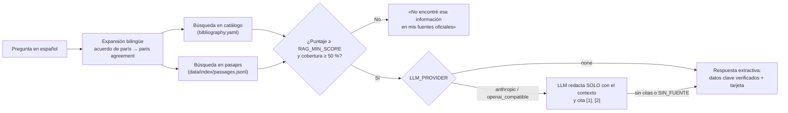

# 05 · Biblioteca climática y RAG

**RAG** (*Retrieval-Augmented Generation*, generación aumentada por recuperación) significa que el bot primero **busca** en sus documentos y después **responde usando solo lo encontrado**. Si no encuentra fuente, lo dice. Así no inventa tratados, fechas ni acuerdos.

## Flujo



## Las tres capas de protección contra respuestas inventadas

1. **Filtro de recuperación.** Un documento solo cuenta si su puntaje supera `RAG_MIN_SCORE` **y** cubre al menos la mitad de la pregunta, ponderando por rareza de las palabras. Esto evita que «¿quién ganó el mundial?» se responda con la COP28 solo porque ambos contienen «mundial».
2. **Respuesta extractiva por defecto.** Sin LLM, el bot cita los `key_facts` del catálogo (escritos y verificados por el equipo) y, si hay texto descargado, un fragmento literal del documento con su idioma original.
3. **Guardas del LLM.** Si activas un modelo, recibe instrucciones de usar únicamente el contexto, citar con [n] y responder `SIN_FUENTE` si no basta. Si no cita, el bot descarta su texto y vuelve al modo extractivo.

## Enrutador de recomendaciones

`backend/app/fulfillment/recommender.py` asigna lecturas según el perfil con un puntaje explicable: +3 si el nivel coincide, +1 si es adyacente, +2 si sirve al programa de interés, +1 si coincide con el tema pedido y −5 si ya se recomendó. Al perfil «aprender» (8 a 14 años) nunca le recomienda documentos avanzados. Para cambiar qué se recomienda, ajusta `level`, `programs` y `tags` en `bibliography.yaml`; no hace falta tocar código.

## Ingesta del texto completo

```bash
pip install pypdf                          # para el PDF «How to COP»
python scripts/ingest_bibliography.py
```

Descarga cada documento con `ingest: true`, quita menús y líneas repetidas entre páginas, y lo trocea en fragmentos de unos 900 caracteres. En la prueba del 12 de octubre de 2026 se obtuvieron fragmentos de 10 de 12 documentos. Las páginas de la Convención y de órganos subsidiarios devolvieron una página de verificación anti-bots; para ellas el bot usa el catálogo.

## Evaluación: el «examen» del bot

`backend/tests/test_rag.py → GOLDEN` contiene preguntas con el documento que debe aparecer primero, y preguntas fuera de tema que **no** deben tener respuesta. Corre en cada PR. Cuando agregues documentos, agrega 1 o 2 preguntas.

## Mejoras opcionales

| Mejora | Cómo activarla | Cuándo vale la pena |
|---|---|---|
| Búsqueda semántica multilingüe | `pip install sentence-transformers numpy` y `RAG_RETRIEVER=embeddings` | Si la gente pregunta con palabras muy distintas a las del catálogo. Pruébala localmente: no corre en CI |
| Redacción con LLM | `LLM_PROVIDER=anthropic` u `openai_compatible` + `LLM_MODEL` + `LLM_API_KEY` | Si quieres respuestas más conversacionales. Ollama local (`LLM_BASE_URL=http://localhost:11434/v1`) evita enviar datos a terceros |
| Base vectorial (ChromaDB, pgvector) | Sustituye `EmbeddingRetriever` conservando `search()` | Con cientos de documentos o más. Con 16 documentos no aporta |

**Sobre U-Net:** es una arquitectura de segmentación de imágenes. Solo tendría sentido si la biblioteca incluyera mapas o figuras que analizar píxel por píxel, lo cual no es el caso.
